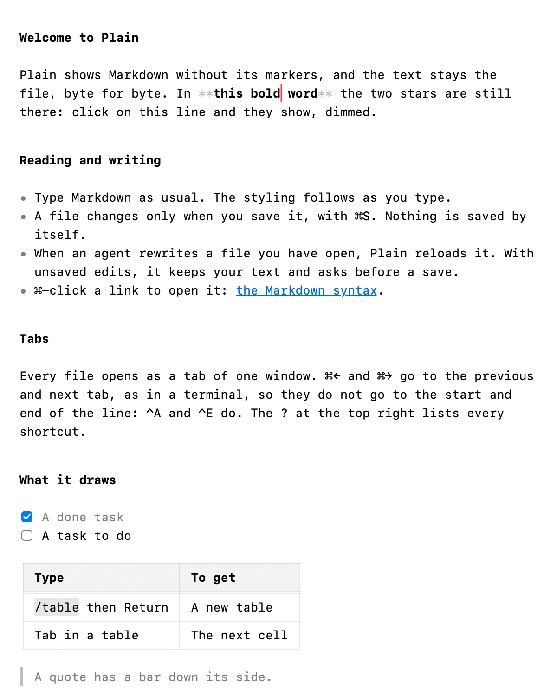

# Plain

A very lightweight native Mac app to read and edit Markdown. Free. By [Clément Rog](https://clementrog.com).

**[Download Plain](https://github.com/clementrog/plain/releases/latest/download/Plain.zip)** for macOS 26 on Apple Silicon. Signed and notarized. Unzip it and drag it to Applications.



## What it does

- Shows Markdown without its markers. The file stays exactly what you typed, byte for byte.
- Saves only when you press ⌘S.
- One window, one tab per file. ⌘← and ⌘→ switch tabs.
- Draws tables. Type `/table` then Return to make one.
- Opens YAML too.
- Never uses the network.

No settings, no themes, no autosave. On purpose.

## With agents

When an agent rewrites a file you have open, Plain reloads it. Unsaved edits stay yours.

An agent can file a bug for you:

```
/Applications/Plain.app/Contents/MacOS/Plain --feedback
```

## Make it your Markdown app

In Finder, select a `.md` file, File > Get Info, pick Plain under "Open with", then "Change All…".

## Problems

[Open an issue](https://github.com/clementrog/plain/issues/new), or use Help > Send Feedback… in Plain. Issues are public, so leave out anything private.

Plain is free to use. The source is not public.
