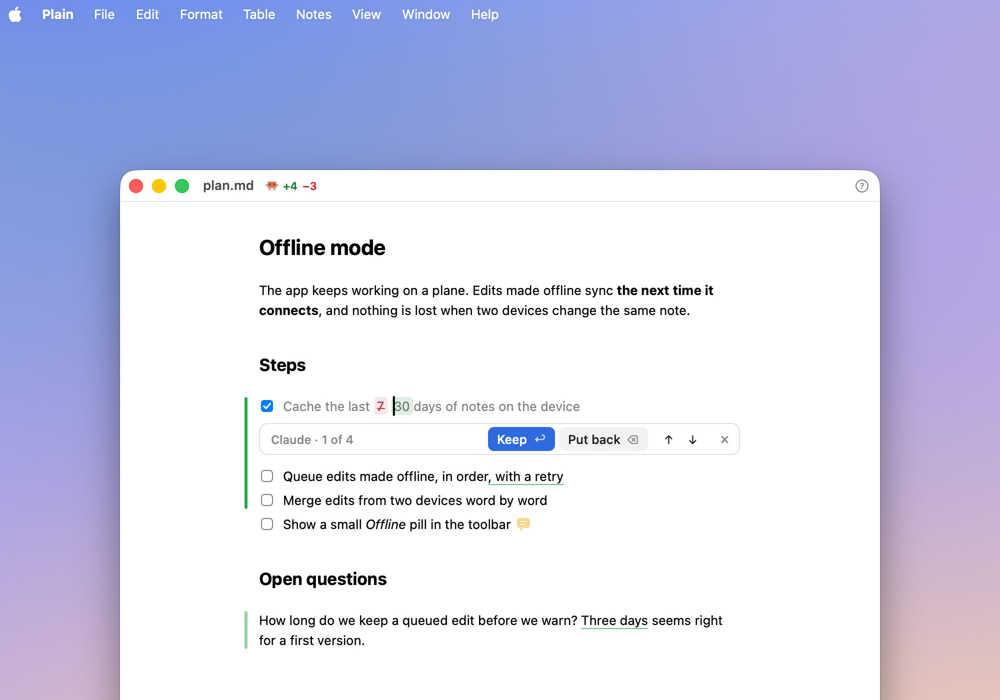

# Plain

A very lightweight native Mac app to read and edit Markdown. Free. By [Clément Rog](https://clementrog.com).

Website: **[plainmac.com](https://plainmac.com)**, where you can try the editor in your browser.

**[Download Plain](https://github.com/clementrog/plain/releases/latest/download/Plain.zip)** for macOS 26 on Apple Silicon. Signed and notarized. Unzip it and drag it to Applications.



## What it does

- Shows Markdown without its markers. The file stays exactly what you typed, byte for byte.
- Shows the markers under the caret once it rests there, and never moves your text to do it: a heading's `##` hangs in the margin, a task keeps its box, a code block keeps its height.
- Return goes on with a quote, a list or a task, and an empty line ends it. After ```` ``` ```` it closes the code block for you. ⇧Return is a plain line break.
- Puts the text in a column about 80 characters wide. A wide table can use the whole window.
- Saves only when you press ⌘S.
- One window, one tab per file. ⌘← and ⌘→ switch tabs. Double-click a tab to rename its file.
- Draws tables. Type `/table` then Return to make one.
- ⌘K for every command. Its footer says what Return will do.
- System Mono or System Sans, in View > Font.
- Opens YAML too.
- Never uses the network.

No settings, no themes, no autosave. On purpose.

## With agents

- **See what the agent changed.** When an agent rewrites a file, Plain shows what changed since you last read it: new words in green, a small red mark where text was removed (click it to put the text back). A bar under the tabs counts the changes, with arrows to go through them (⌥⌘G) and Mark as Seen (⌥⌘Y). What you last read stays on your Mac.
- **Keep your unsaved edits.** When the agent changed other words than yours, its changes merge into your text. When you both changed the same words, the agent's lines show in a box under yours, with Keep mine and Take theirs.
- **Leave notes for the agent.** Select a passage, ⌥⌘M, type. The note goes in the file as `<!-- note: … -->`. In a code block or a table, the note goes on its own line above it, so the code stays untouched. In code it names the lines you selected. Then tell your agent "do my notes".
- **Let the agent see what you changed** since its last write:

  ```
  /Applications/Plain.app/Contents/MacOS/Plain --changes plan.md
  ```

- **Files that move stay open.** A file an agent renames or moves keeps its tab.
- **Links like `plan.md:42`** open at that line. ⇧⌘O jumps to a heading. Type `@` to link another doc.
- **Use Plain as your editor** for git commit messages, and for Ctrl-G in Claude Code and Codex:

  ```
  export EDITOR="/Applications/Plain.app/Contents/MacOS/Plain --wait"
  ```

An agent can file a bug for you:

```
/Applications/Plain.app/Contents/MacOS/Plain --feedback
```

## Make it your Markdown app

In Finder, select a `.md` file, File > Get Info, pick Plain under "Open with", then "Change All…".

## Problems

[Open an issue](https://github.com/clementrog/plain/issues/new), or use Help > Send Feedback… in Plain. Issues are public, so leave out anything private.

Plain is free to use. The source is not public.
